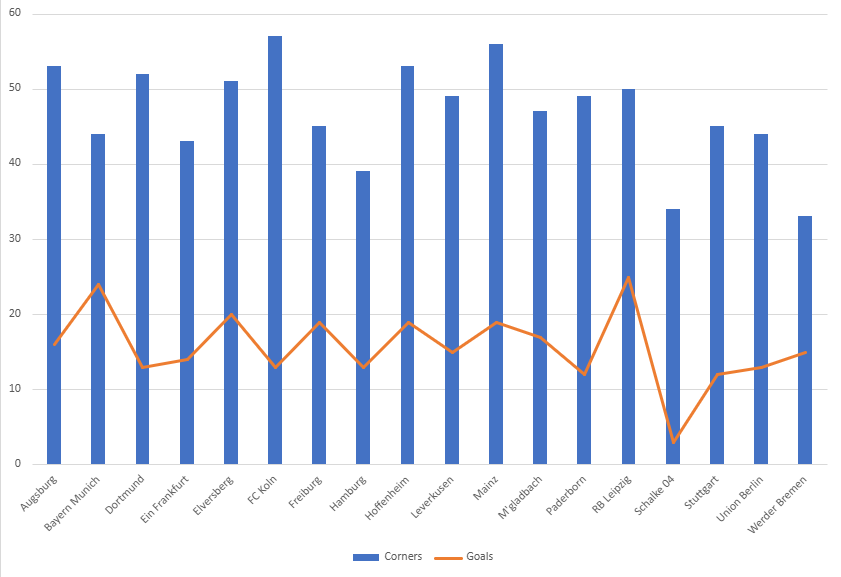

# Football Data & Scouting Portfolio

Welcome to my portfolio! I am a passionate football enthusiast with a background as a goalkeeper. My goal is to bridge the gap between tactical football knowledge and data-driven decision-making.

## 🎯 My Focus
- *Scouting & Match Analysis:* Creating detailed player reports and tactical game analyses.
- *Data Visualization:* Building interactive dashboards to make complex data understandable for coaches (currently focusing on Power BI & Excel).
- *Coaching:* Designing training sessions based on analytical insights.

## 🛠️ Skills & Tools
- *Analysis:* Tactical match analysis, player evaluation, KPI creation.
- *Tools:* Power BI, Excel (learning and building projects), basic knowledge of open football data sources.
- *Football Knowledge:* Practical experience as a player (goalkeeper), trainer, and completed scouting foundations.

## 📂 Projects
Here I will publish my work, including:

### Corners vs. Goals Analysis
This combination chart compares the total corners generated by each team against the total goals scored. The blue bars represent corners, while the orange line represents goals.

https://1drv.ms/x/c/86f5fde818f0dca3/IQBlIa2hDiyYR6kYmZNBi-RrAXnKzjiBFGOsV09MP2sBM2U?e=bvqlEV
**Key Insights:**
*   **Quantity vs. Quality (The 1. FC Köln case):** 1. FC Köln has generated the highest number of corners in the league (57), yet they have scored only 13 goals. This highlights a severe inefficiency in converting set-pieces into actual goal threats.
*   **Elite Efficiency:** Teams like Bayern Munich (24 goals) and RB Leipzig (25 goals) are much more clinical. They do not need the highest volume of corners to score frequently, indicating superior overall attacking quality and better finishing.

**Analytical Takeaway:** 
While generating a high volume of corners indicates territorial dominance, it does not automatically lead to goals. Coaches must evaluate the *quality* of set-pieces. Teams like Köln may need to shift their training focus towards crossing accuracy and attacking movements in the box, rather than just volume.

- [ ] Player Scouting Reports (PDF/Excel)
- [ ] Interactive Match Dashboards (Power BI)
- [ ] Tactical Match Analyses
      
Stay tuned!
